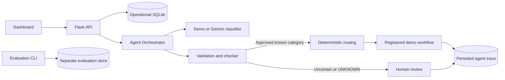

# Intelligent Agentic AI Router

**P18: Closed-Set Classification and Deterministic Workflow Routing**

A local Flask application that classifies natural-language requests into a fixed category set, validates confidence, routes through a readable allowlist, and records decisions in SQLite. Uncertain requests wait for a human decision. The LLM never receives a workflow function or permission to create a route.

## Technology stack

- Python 3.10+, Flask, SQLite
- Google `google-genai` SDK for optional Gemini classification
- HTML, CSS, and vanilla JavaScript dashboard
- Gunicorn WSGI server for Linux deployment
- pytest for automated tests

## What is implemented

- Seven configured categories and an explicit category-to-workflow table in `config/`.
- A clearly labeled, key-free mock `demo` provider and a real Gemini provider using Google's official `google-genai` SDK.
- Classification structure, category, confidence, and review validation before workflow execution.
- An execution registry containing safe demonstration handlers. These return a structured message and request summary; they do not modify accounts, access external data, or perform real-world actions.
- Human approve, reject, and clarification actions. Approval executes only the category's predefined registered workflow; `UNKNOWN` cannot be approved for execution.
- A central orchestrator coordinates classification, validation, deterministic routing, execution, review, and checker agents using structured results and a shared per-request context.
- SQLite execution traces record each real agent invocation, status, timestamps, inputs, outputs, errors, checker feedback, and retry attempt. The dashboard's Agent activity section displays the live/current stage, timeline, failures, and retry feedback.
- The checker verifies classification structure, validation decisions, category-to-workflow consistency, execution results, and human review transitions. It allows at most one classification/validation retry; execution is never automatically retried.
- Unsupported and malformed classifier outputs are held in the review queue; provider failures are recorded as failed requests and never routed.
- SQLite audit history, filtering, dashboard metrics, and a labeled evaluation dataset with computed accuracy, macro precision/recall/F1, confidence range, review rate, and confusion matrix.
- A versioned 222-case holdout benchmark covering the six configured intents plus `UNKNOWN`, with deterministic reproducible context variants, closed-set classification metrics, routing and safety checks, actual isolated agent traces, latency percentiles, robustness probes, and downloadable JSON/CSV reports.
- Evaluation requests use a temporary SQLite history; benchmark run metadata and per-case outcomes are stored in a separate SQLite database and never enter ordinary dashboard request history.
- Flask REST API and a responsive HTML/CSS/JavaScript dashboard served from the same origin.

The architecture uses specialized classification, validation, routing, execution, and review responsibilities. This applies the research paper's assistant/checker separation selectively; it does not claim to reproduce ResilioMate or its experiments. The IEEE paper's bibliographic metadata was checked against its DOI record, but its full text was not present in the workspace. The Autonomy Ladder Project Catalogue file was also unavailable, so its citation is limited to the P18 title supplied with the project.

## Project documentation

The following documentation describes the implementation currently present in this repository:

- [Academic project report](PROJECT_REPORT.md)
- [Architecture and diagrams](ARCHITECTURE.md)
- [HTTP API reference](API_DOCUMENTATION.md)
- [Automated testing report](TESTING_REPORT.md)
- [Evaluation report](EVALUATION_REPORT.md)
- [Deployment guide (Render)](DEPLOYMENT.md)
- [Mermaid diagram sources](diagrams/)

The IEEE paper's bibliographic metadata is listed in the project report and was checked against its DOI record. The Autonomy Ladder Project Catalogue file was not available in the workspace; the P18 citation therefore uses only the project title supplied in the task and explicitly marks missing catalogue publication metadata.

This repository contains Markdown and Mermaid source documentation. A PDF renderer is not installed in the current environment, so no PDF is included; the academic report is maintained as `PROJECT_REPORT.md`.

No screenshots are currently included. No software license has been selected; the project owner should choose and add an appropriate license before public distribution. Do not imply that source reuse is permitted until a license is added.

## GitHub preparation

This workspace currently has no Git repository metadata. After reviewing the staged file list and confirming no secrets or local databases are included, initialize and commit locally with:

```powershell
git init -b main
git status --short --branch
git add -A
git diff --cached --check
git diff --cached --name-only
git diff --cached --stat
git commit -m "Initial P18 project release"
git remote add origin https://github.com/<OWNER>/<REPOSITORY>.git
git push -u origin main
```

Replace the remote URL with the repository you own. The push command is shown for convenience but has **not** been run; obtain explicit project-owner confirmation before pushing. If GitHub already contains commits, inspect and integrate them without force-pushing or rewriting history. No license is included because the project owner has not selected one.

## Requirements

- Python 3.10 or newer
- pip

## Run locally

From the project root in PowerShell:

```powershell
py -m venv .venv
.\.venv\Scripts\Activate.ps1
python -m pip install -r requirements-dev.txt
Copy-Item .env.example .env
$env:LLM_PROVIDER = "demo"
python -m backend.app
```

Open http://127.0.0.1:5000. Demo mode is deterministic, clearly labeled **DEMO MOCK MODE** in the dashboard, and does not require an API key. It is a transparent keyword-based demonstration classifier, not a production-grade semantic model.

## Gemini Real Mode

Put a valid Gemini Developer API key in `.env` (the file is ignored by Git), then select real mode:

```powershell
$env:LLM_PROVIDER = "gemini"
$env:GEMINI_API_KEY = "your-key"
$env:GEMINI_MODEL = "gemini-3.8-flash"
python -m backend.app
```

Alternatively, edit `.env` with `LLM_PROVIDER=gemini`, `GEMINI_API_KEY`, and `GEMINI_MODEL` (defaults to `gemini-3.8-flash`). The app loads `.env` at startup. `LLM_TIMEOUT` (seconds), `CONFIDENCE_THRESHOLD`, `DATABASE_PATH`, and `PORT` are configurable. The dashboard identifies **GEMINI / REAL LLM MODE**. Missing credentials fail startup; provider timeouts, rate limits, authentication failures, and service outages return sanitized errors and are logged. Real mode never silently switches to the mock classifier. API keys are not included in frontend responses.

The provider uses Google's official [`google-genai` SDK](https://googleapis.github.io/python-genai/), with a JSON response schema containing only configured categories. The response is parsed and passed through the existing validation, routing, execution, and review agents. Model confidence remains an estimate and is not statistically calibrated.

## Test and evaluate

Install test dependencies with `python -m pip install -r requirements-dev.txt`, then run:

```powershell
python -m pytest -q
python -m backend.evaluate
python -m backend.evaluate --provider gemini
```

The benchmark dataset is [`data/evaluation_dataset_v2.json`](data/evaluation_dataset_v2.json), version `2.0.0`. It contains 37 distinct, labeled seed prompts, expanded into 222 unique cases with six fixed, documented request-context variants. The labels include all six supported categories and `UNKNOWN`; ambiguous, unsupported, malformed-looking, and adversarial prompts are identified separately. This is a fixed, locally authored evaluation holdout, not classifier training data. Its size and deterministic variants do not make it representative of production traffic.

The default command runs the complete testable workflow with the local mock classifier, writes JSON and CSV snapshots to `data/evaluation_reports/`, and saves run summaries and cases to `data/evaluation_results.sqlite3`. During a run, request records and execution traces are written to an isolated temporary database that is removed afterwards. The command does not populate the ordinary request-history database.

Useful options:

```powershell
python -m backend.evaluate --provider demo
python -m backend.evaluate --provider demo --database .\data\my-evaluations.sqlite3 --output-dir .\data\my-reports
python -m backend.evaluate --provider gemini
python -m backend.evaluate --provider gemini --model gemini-3.8-flash --threshold 0.65 --timeout 20
```

Gemini is opt-in. A full real-provider run sends the 222 benchmark prompts plus one additional request for the controlled checker-retry probe, so it can consume billable quota. Other robustness/repeated/concurrent probes use isolated deterministic demo classifiers. Tests use mocked SDK clients and do not call the paid API. `GEMINI_API_KEY` must be configured for a real-provider run. Results are labeled with provider, model, dataset version and SHA-256; the dashboard only computes provider deltas for stored runs on the identical dataset. No real-provider benchmark is implied by demo output.

The report includes accuracy, macro and weighted F1, per-category precision/recall/F1 and a confusion matrix with `UNKNOWN` included. Escalation recall/rate is reported separately from classification quality. Routing correctness is checked against the configured deterministic map. Checker and agent metrics use recorded executions; the checker recovery number comes from an explicitly identified controlled malformed-response fault-injection probe. Robustness checks cover input bounds, malformed JSON/model output, unsupported categories, provider timeout, adversarial prompts, repeated and concurrent requests, and a controlled database-write failure. Latencies are local end-to-end measurements; classification and workflow spans are read from actual traces. Gemini usage tokens are included only when returned by the provider. API cost remains null because no verified pricing table is configured.

Memory comparison is unavailable because this project has no retrieval or memory module. A checker-disabled baseline is intentionally not run because it would disable a routing safety control. Comparing different providers on the same fixed dataset is descriptive and does not establish a causal or production-quality improvement. Use a larger representative, independently labeled set and repeat runs before drawing general conclusions.

Evaluation runs are visible from the dashboard's **Evaluation** section.

## API

| Method | Path | Purpose |
| --- | --- | --- |
| `GET` | `/api/health` | Health and provider mode |
| `GET` | `/api/dashboard` | Statistics, categories, filtered history, and pending review/clarification queue; optional `search`, `status`, `category`, `from`, and `to` filters |
| `GET` | `/api/analytics` | Record-derived KPIs and chart series; optional ISO-date `from` and `to` filters |
| `POST` | `/api/requests` | Classify, validate, and route a request; body: `{"request":"..."}` |
| `POST` | `/api/reviews/<id>` | Resolve review; body: `{"action":"approve|reject|clarify","feedback":"..."}` |
| `GET` | `/api/requests/<id>/trace` | Retrieve the full recorded agent execution trace for a request |
| `GET` | `/api/agent-activity` | Retrieve the currently processing request's trace, or the latest completed trace |
| `GET` | `/api/history` | Searchable request records; optional `search`, `status`, `category`, `from`, and `to` filters |
| `GET` | `/api/evaluations` | List stored evaluation run summaries |
| `GET` | `/api/evaluations/<run_id>` | Retrieve run metrics, confusion matrix, comparisons, and limitations |
| `GET` | `/api/evaluations/<run_id>/download?format=json` | Download the full JSON report, including per-case results |
| `GET` | `/api/evaluations/<run_id>/download?format=csv` | Download per-case benchmark results as CSV |

Request bodies must be JSON objects and requests are limited to 4,000 characters. Invalid or untrusted categories cannot select a workflow. Malformed classifier output is recorded as `UNKNOWN` for human review; provider/processing failures are logged with a generic client response.

The dashboard refreshes request history and analytics every five seconds and polls persisted agent activity every two seconds. Search, category, status, and date controls filter the request history; date bounds also filter analytics. KPIs and charts are queried from SQLite request and agent-execution records, including measured workflow and agent latency. Offline benchmark runs appear separately in the Evaluation section and are not mixed with operational request metrics. Memory is not implemented in this project, so the memory section reports that its records are unavailable rather than showing sample data.

## Architecture



Editable Mermaid source diagrams are in [`diagrams/`](diagrams/), with design and constraints documented in [`ARCHITECTURE.md`](ARCHITECTURE.md).

```text
frontend (same-origin dashboard)
  -> Flask API
  -> central agent orchestrator / shared request context
  -> classification agent (demo or configured LLM provider)
  -> checker agent + validation agent (closed set + confidence)
  -> checker agent + deterministic routing table
  -> registered workflow executor OR SQLite human-review queue
  -> checker verifies result / review transition
  -> SQLite request history, agent execution trace, and dashboard
```

Category identifiers and their workflow names are defined in `config/categories.json`; routing rules are separately readable in `config/routing_rules.json`. Category-to-handler matching is checked before execution, and the executor itself only accepts locally registered workflow names.

The orchestration retry policy is intentionally narrow: malformed/incomplete classification or a rejected validation result can trigger one additional classification attempt. When it remains invalid, the request is escalated to human review without routing or execution. Provider outages and workflow execution failures are recorded and surfaced, not retried. Human approval is required for held requests; `UNKNOWN` remains non-executable. Trace inputs/outputs are stored alongside local request history in SQLite.

## Evaluation limitations

Confidence is a provider score, not a calibrated probability. The demo provider uses fixed heuristic scores. Latency and execution metrics in the dashboard reflect actual local request records, while the offline evaluation dataset reports classification metrics only. The demo workflows intentionally avoid external side effects; replacing them with real integrations requires independent authorization, input validation, and operational safety checks.